# FINOVA – Database Architecture & Schema Documentation

## 1. Overview
The FINOVA database is built on **MySQL 8.0** using standard InnoDB tables, strict UTF-8 (`utf8mb4_unicode_ci`) encoding, UTC timestamping, and exact `DECIMAL(12,2)` precision for all currency balances, calculations, and financial aggregations.

---

## 2. Entity-Relationship Model

```mermaid
erDiagram
    USERS ||--o{ USER_ROLES : has
    ROLES ||--o{ USER_ROLES : assigned
    USERS ||--o| USER_PROFILES : details
    USERS ||--o{ REFRESH_TOKENS : authenticates
    USERS ||--o{ INCOMES : earns
    USERS ||--o{ EXPENSES : incurs
    USERS ||--o{ BUDGETS : plans
    BUDGETS ||--o{ BUDGET_CATEGORIES : allocates
    USERS ||--o{ SAVINGS_GOALS : targets
    SAVINGS_GOALS ||--o{ SAVINGS_CONTRIBUTIONS : deposits
    USERS ||--o{ DEBTS : manages
    DEBTS ||--o{ DEBT_REPAYMENTS : settles
    USERS ||--o{ SUBSCRIPTIONS : tracks
    USERS ||--o{ RECURRING_TRANSACTIONS : schedules
    USERS ||--o{ NOTIFICATIONS : receives
    USERS ||--o{ EXPENSE_SPLITS : organizes
    EXPENSE_SPLITS ||--o{ EXPENSE_SPLIT_MEMBERS : includes
    USERS ||--o{ FINANCIAL_JOURNALS : reflects
    USERS ||--o{ CHALLENGE_PARTICIPANTS : joins
    FINANCIAL_CHALLENGES ||--o{ CHALLENGE_PARTICIPANTS : hosts
    USERS ||--o{ SUPPORT_TICKETS : creates
    USERS ||--o{ AUDIT_LOGS : records
```

---

## 3. Core Database Tables

### 3.1 Authentication & User Identity
- **`roles`**: System roles (`ROLE_STUDENT`, `ROLE_ADMIN`).
- **`users`**: Core user entity (`email`, `password_hash`, `full_name`, `is_active`, `is_verified`, `created_at`).
- **`user_roles`**: Many-to-many relationship linking `users` to `roles`.
- **`user_profiles`**: Student-specific metadata (`college_name`, `student_status`, `currency`, `monthly_allowance`, `avatar_url`, `timezone`, `notification_email_enabled`, `notification_in_app_enabled`).
- **`refresh_tokens`**: Rotating cryptographically-secure JWT refresh tokens with expiry timestamps and revocation status.

### 3.2 Income & Outflow Ledger
- **`expense_categories`**: Normalized category names (`Food`, `Transportation`, `Education`, `Shopping`, `Entertainment`, `Accommodation`, `Healthcare`, `Mobile and Internet`, `Subscriptions`, `Personal Care`, `Other`).
- **`incomes`**: Student inflows (`title`, `amount DECIMAL(12,2)`, `category`, `income_date`, `payment_method`, `is_recurring`, `description`).
- **`expenses`**: Student outflows (`title`, `amount DECIMAL(12,2)`, `category_id`, `expense_date`, `payment_method`, `receipt_url`, `is_recurring`, `description`).

### 3.3 Planning & Limits
- **`budgets`**: Monthly budget plans (`month`, `year`, `total_budget_limit DECIMAL(12,2)`).
- **`budget_categories`**: Category allocations (`allocated_amount DECIMAL(12,2)`). Enforces real-time 70% caution, 90% high warning, and 100% exceeded alert thresholds.

### 3.4 Savings Vaults
- **`savings_goals`**: Milestones (`goal_name`, `target_amount`, `current_amount`, `target_date`, `status`).
- **`savings_contributions`**: Timestamped incremental deposits into goals (`amount`, `contribution_date`, `notes`).

### 3.5 Peer Debts & Subscriptions
- **`debts`**: Peer loans (`person_name`, `debt_type` [BORROWED/LENT], `initial_amount`, `remaining_amount`, `interest_rate`, `due_date`, `status` [ACTIVE/PAID/OVERDUE]).
- **`debt_repayments`**: Partial or full repayment records (`amount`, `repayment_date`, `notes`).
- **`subscriptions`**: Recurring memberships (`name`, `amount`, `billing_cycle` [MONTHLY/ANNUAL/WEEKLY], `category`, `next_billing_date`, `is_active`, `remind_before_days`).

### 3.6 Advanced Financial Modules
- **`expense_splits`**: Group bills (`title`, `total_amount`, `split_type`, `is_settled`).
- **`expense_split_members`**: Group members (`member_name`, `allocated_amount`, `has_paid`).
- **`financial_journals`**: Emotional money reflections (`title`, `reflection_text`, `sentiment` [PROUD/NEUTRAL/REGRETFUL/MOTIVATED], `entry_date`).
- **`financial_challenges`**: Gamified milestones (`title`, `target_savings`, `duration_days`, `badge_name`).
- **`challenge_participants`**: Student enrollment and progress tracking.

### 3.7 System Operations & Audit
- **`notifications`**: In-app alerts (`title`, `message`, `type`, `is_read`, `created_at`).
- **`support_tickets`**: Student queries with admin responses and status.
- **`audit_logs`**: Immutable security log (`user_id`, `action`, `details`, `ip_address`, `timestamp`).

### 3.8 Google Integration Suite
- **`google_accounts`**: Student Google identities (`user_id`, `google_user_id`, `google_email`, `profile_picture`, timestamps).
- **`google_integrations`**: Service connection registry (`user_id`, `service_name` [AUTH/CALENDAR/SHEETS/DRIVE/GMAIL/MAPS], `connection_status`, `scopes`, `last_sync_at`).
- **`google_oauth_tokens`**: Encrypted credentials (`user_id`, `encrypted_access_token`, `encrypted_refresh_token`, `expires_at`). Authenticated with **AES-256-GCM**.
- **`google_calendar_events`**: 2-way event mapping for duplicate prevention (`user_id`, `financial_record_id`, `google_event_id`, `event_type`, `event_date`, `sync_status`).
- **`google_drive_files`**: Cloud backup registry (`user_id`, `google_file_id`, `file_name`, `file_type`, `folder_path`, `file_size`, `web_link`).
- **`google_sync_logs`**: Integration audit trail (`user_id`, `service_name`, `sync_status`, `error_message`, `details`, `synced_at`).

---

## 4. Indexing & Optimization Strategy
1. **Tenant Isolation**: High-frequency queries filter by `user_id`; indexes exist on `(user_id, income_date)` and `(user_id, expense_date)`.
2. **Monthly Aggregation**: Index on `budgets(user_id, year, month)` ensures $O(1)$ lookup for current period limits.
3. **Foreign Keys**: Cascading deletion configured on member tables (`debt_repayments`, `budget_categories`, `savings_contributions`) to maintain referential integrity.
